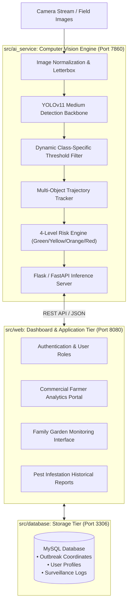

# GreenTech-AI: Intelligent Agricultural Pest Monitoring Platform

[](https://www.python.org/)
[](https://github.com/ultralytics/ultralytics)
[](https://opencv.org/)
[](https://www.php.net/)
[](https://www.mysql.com/)
[](https://www.docker.com/)
[](LICENSE)

> Production-ready, edge-compatible Computer Vision platform utilizing fine-tuned YOLOv11 Medium and OpenCV to detect, track, and alert against 5 common agricultural pest species with an automated 4-level risk warning engine.

---

## 1. System Architecture Overview

Following Clean Architecture standards, the solution segregates computer vision inference, user workflow presentations, and persistence schemas into distinct boundaries.



Detailed architectural specifications and mathematical formulations are documented in [docs/ARCHITECTURE.md](docs/ARCHITECTURE.md).  
Student scientific research (NCKH) methodology and experimental benchmarks are documented in [docs/RESEARCH_PAPER.md](docs/RESEARCH_PAPER.md).

---

## 2. Core Features & Capabilities

1. **Precision Pest Classification (YOLOv11 Medium):**
   * Real-time inference across 5 high-impact agricultural pest species in Vietnam:
     * **Rệp mềm (Aphids)**
     * **Bọ cánh cứng (Beetles)**
     * **Châu chấu (Grasshoppers)**
     * **Ốc sên (Snails)**
     * **Sâu hại (Caterpillars / Larvae)**
2. **Automated 4-Level Outbreak Early Warning Engine:**
   * **Level 1: Xanh (Safe):** $\le 2$ pests detected; regular surveillance cycle.
   * **Level 2: Vàng (Caution):** $3 - 5$ pests detected; elevated sampling recommended.
   * **Level 3: Cam (Warning):** $6 - 10$ pests detected; localized biological treatment alert.
   * **Level 4: Đỏ (Critical):** $> 10$ pests detected; emergency containment quarantine alert.
3. **Dual Stakeholder Dashboards:**
   * **Farmer Dashboard:** Large-scale acreage tracking, chemical/biological treatment recommendation ledger, and epidemic heatmaps.
   * **Family Garden Dashboard:** Streamlined user experience for urban farming, greenhouse, and rooftop balcony garden management.

---

## 3. Repository Structure

```text
GreenTech-AI/
├── src/
│   ├── ai_service/             # YOLOv11 Computer Vision inference pipeline
│   │   ├── api_model.py        # Model loader, tracking & REST endpoints
│   │   ├── export_utils.py     # CSV/JSON export utilities
│   │   └── requirements.txt    # Python dependencies (Torch, Ultralytics, OpenCV)
│   ├── web/                    # Presentation and business workflow layer
│   │   ├── index.php           # Unified application portal
│   │   ├── dashboard_*.php     # Specialized farmer & family garden portals
│   │   ├── thong_ke.php        # Real-time analytics & charts
│   │   ├── process_*.php       # Request handlers & async live processors
│   │   ├── ai_config.php       # AI backend connectivity settings
│   │   ├── db_connect.php      # Database connection pooling
│   │   └── pest_translate.php  # Scientific nomenclature mapper
│   └── database/               # Relational database schemas
│       └── nckh_giam_sat_dich_hai.sql
├── deploy/                     # Deployment configurations
│   ├── Dockerfile              # Python + OpenCV container definition
│   └── docker-compose.yml      # Multi-container stack (AI, Web, MySQL)
├── docs/                       # Technical & Academic documentation
│   ├── ARCHITECTURE.md         # Full Clean Architecture documentation
│   └── RESEARCH_PAPER.md       # Student scientific research paper summary
├── .env.example
├── .gitignore
├── LICENSE
└── README.md
```

---

## 4. Quickstart Guide

### Running with Docker Compose (Recommended)

```bash
# Clone the repository
git clone https://github.com/thienlotus/GreenTech-AI.git
cd GreenTech-AI

# Launch the entire multi-container ecosystem
cd deploy
docker-compose up -d --build
```

* **Web Application Portal:** `http://localhost:8080`
* **AI Model Inference Server:** `http://localhost:7860`
* **MySQL Database:** `localhost:3306`

### Running the Python AI Inference Engine Locally

```bash
cd src/ai_service
python -m venv venv
# On Windows:
.\venv\Scripts\activate
# On Linux/macOS:
source venv/bin/activate

pip install -r requirements.txt
python api_model.py
```

---

## 5. Author & Academic Attribution

* **Lê Vũ Thiên** (`@thienlotus`)
* AI & Software Engineering Student | Focus: Computer Vision, Clean Architecture & Enterprise Backend
* Location: Hanoi, Vietnam
* Email: [thienchip1310@gmail.com](mailto:thienchip1310@gmail.com)
* GitHub: [https://github.com/thienlotus](https://github.com/thienlotus)

---

## 6. License

This project is licensed under the MIT License - see the [LICENSE](LICENSE) file for details.
