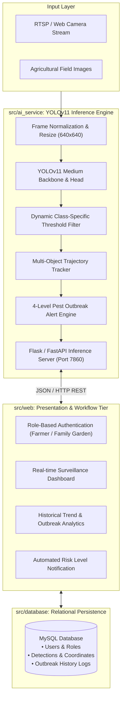

# GreenTech-AI Architecture & Technical Specifications

> **System Author & AI Engineer:** Lê Vũ Thiên (`@thienlotus`)  
> **Technologies:** Python 3.9+, YOLOv11 Medium, OpenCV, PyTorch, PHP 8.2, MySQL 8.0, Docker  
> **Domain:** Applied Artificial Intelligence, Edge Computer Vision & Smart Agriculture

---

## 1. High-Level Architecture Overview

GreenTech-AI follows **Clean Architecture** principles, cleanly separating the AI Computer Vision Inference engine, the Web Application & Data Management layer, and the Relational Persistence schema.



---

## 2. Computer Vision Pipeline (YOLOv11 Medium)

### Detection Target Classes
The model is fine-tuned to classify 5 high-impact agricultural pest species common in Vietnam:
1. **Rệp mềm (Aphids)**
2. **Sâu hại (Caterpillars / Worms)**
3. **Bọ cánh cứng (Beetles)**
4. **Châu chấu (Grasshoppers)**
5. **Ốc sên (Snails)**

### Inference Flow
1. **Input Transformation:** Frames from video or images are resized to $640 \times 640$ keeping aspect ratio with letterboxing.
2. **Dynamic Confidence Thresholding:** Unlike naive models applying a static 0.5 threshold across all classes, GreenTech-AI applies calibrated class-specific thresholds (`get_threshold_for_class`) to prevent false positives for small insects like aphids:
   $$\text{Accept}(B_i) \iff \text{Confidence}(B_i) \ge \tau(c_i)$$
3. **Object Tracking:** Assigns consistent IDs across consecutive frames to prevent duplicate counts of stationary pests.

---

## 3. Four-Level Outbreak Early Warning Engine

The system quantifies risk dynamically based on pest density and growth rate over monitored zones:

| Alert Level | Indicator | Density Metric | Recommended Intervention |
| :--- | :--- | :--- | :--- |
| **Level 1: Xanh (Safe)** | Green | $\le 2$ pests / zone | Standard regular field inspection |
| **Level 2: Vàng (Caution)** | Yellow | $3 - 5$ pests / zone | Increased camera sampling, biological controls |
| **Level 3: Cam (Warning)** | Orange | $6 - 10$ pests / zone | Localized targeted botanical spraying |
| **Level 4: Đỏ (Critical)** | Red | $> 10$ pests / zone | Immediate emergency treatment, quarantine alert |

---

## 4. Directory & Module Responsibilities

```text
GreenTech-AI/
├── src/
│   ├── ai_service/             # Pure Python AI Inference Pipeline
│   │   ├── api_model.py        # YOLOv11 inference endpoints & tracking
│   │   ├── export_utils.py     # Data export utilities (JSON/CSV)
│   │   └── requirements.txt    # PyTorch, Ultralytics, OpenCV dependencies
│   ├── web/                    # Presentation Layer (PHP 8.2)
│   │   ├── index.php           # Landing & system overview
│   │   ├── dashboard_*.php     # Farmer and family garden tailored portals
│   │   ├── thong_ke.php        # Statistical reports & charts
│   │   ├── process_*.php       # Async processing handlers
│   │   ├── ai_config.php       # AI endpoint connection parameters
│   │   ├── db_connect.php      # PDO database connection pool
│   │   └── pest_translate.php  # Scientific to Vietnamese nomenclature mapper
│   └── database/               # Relational Schema
│       └── nckh_giam_sat_dich_hai.sql
├── deploy/                     # DevOps & Container Orchestration
│   ├── Dockerfile              # Python + OpenCV container definition
│   └── docker-compose.yml      # Multi-service stack (AI, Web, MySQL)
├── docs/                       # Architectural & Scientific Documentation
│   ├── ARCHITECTURE.md         # This technical specification
│   └── RESEARCH_PAPER.md       # Student scientific research paper summary
├── .env.example
├── .gitignore
├── LICENSE
└── README.md
```
